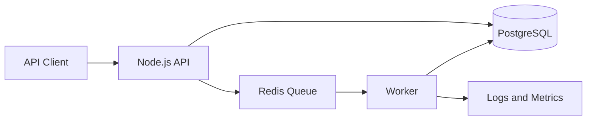

# Relay — Reliable Event Processing API

> A backend engineering reference project exploring reliable asynchronous event processing, idempotency, retries, and operational visibility.

**Status:** Initial implementation / work in progress. This repository is a learning and portfolio project; it is not a production service.

## Why this project

A common backend problem is accepting work quickly while processing it asynchronously and safely. Relay is designed to make the important engineering concerns explicit:

- Accept events through an HTTP API.
- Validate and persist accepted work before acknowledging it.
- Process work asynchronously.
- Prevent duplicate effects with idempotency.
- Retry transient failures with bounded backoff.
- Expose health and operational signals.
- Document failure modes and design trade-offs.

## Planned architecture

PostgreSQL is the durable source of truth for accepted events. Redis/BullMQ is the delivery mechanism for asynchronous work. The design must account for the dual-write boundary between the database and queue; the implementation plan includes an outbox pattern rather than assuming two independent writes are atomic.

## Engineering milestones

- [x] Define problem statement, architecture, and reliability goals.
- [ ] TypeScript API with request validation.
- [ ] PostgreSQL schema and durable event/outbox records.
- [ ] Outbox dispatcher and BullMQ worker.
- [ ] Idempotent processing and bounded retries.
- [ ] Integration tests for duplicate delivery and worker failure.
- [ ] Docker Compose local environment and CI.
- [ ] Load test with documented p50/p95/p99 latency and throughput.
- [ ] Operational guide: queue lag, retry rate, dead-letter handling, graceful shutdown.

## Planned stack

- Node.js + TypeScript
- Fastify or Express for HTTP
- PostgreSQL for durable state
- Redis + BullMQ for background processing
- Vitest for tests
- Docker Compose for local dependencies

The exact framework and dependency choices will be recorded as implementation decisions rather than presented as production experience.

## Reliability questions this project will answer

1. What happens if the API process crashes after committing an event but before enqueueing it?
2. What happens if a worker processes a job but crashes before acknowledging it?
3. How are duplicate requests and duplicate deliveries handled?
4. Which failures are retryable, and how are retries bounded?
5. How is poison work isolated from healthy queue traffic?
6. How do we measure queue lag and end-to-end processing latency?

## Local development

Setup instructions will be added with the first runnable implementation. Until then, this repository contains the project specification and implementation roadmap.

## Engineering notes

Design decisions, failure-mode analysis, test results, and benchmark methodology will be documented in `docs/` as the implementation progresses. Performance numbers will only be published after reproducible tests.

---

Built to demonstrate backend engineering fundamentals through explicit design, implementation, testing, and measured trade-offs.
